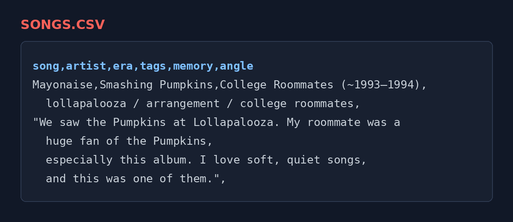
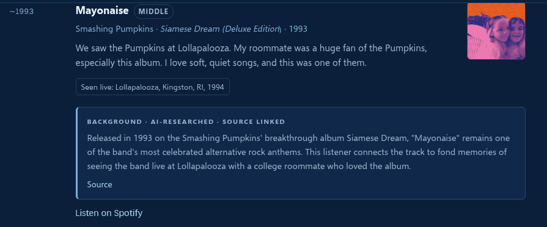
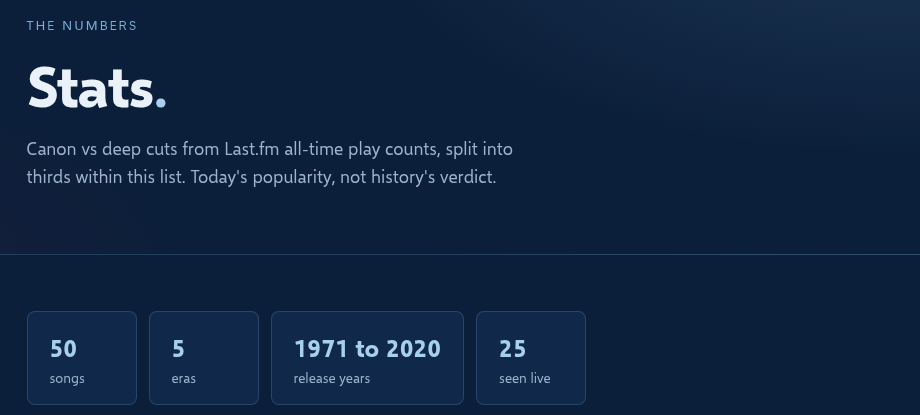
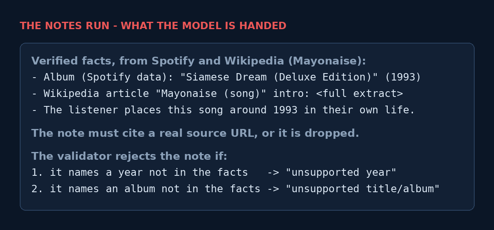
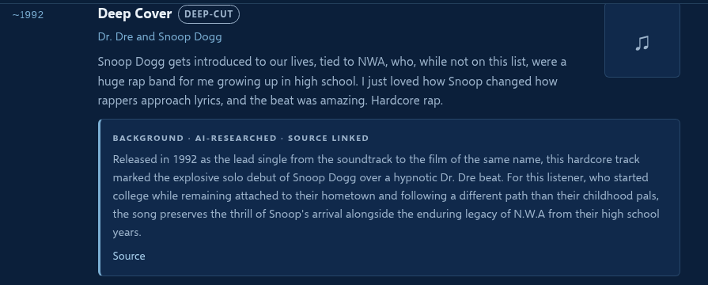
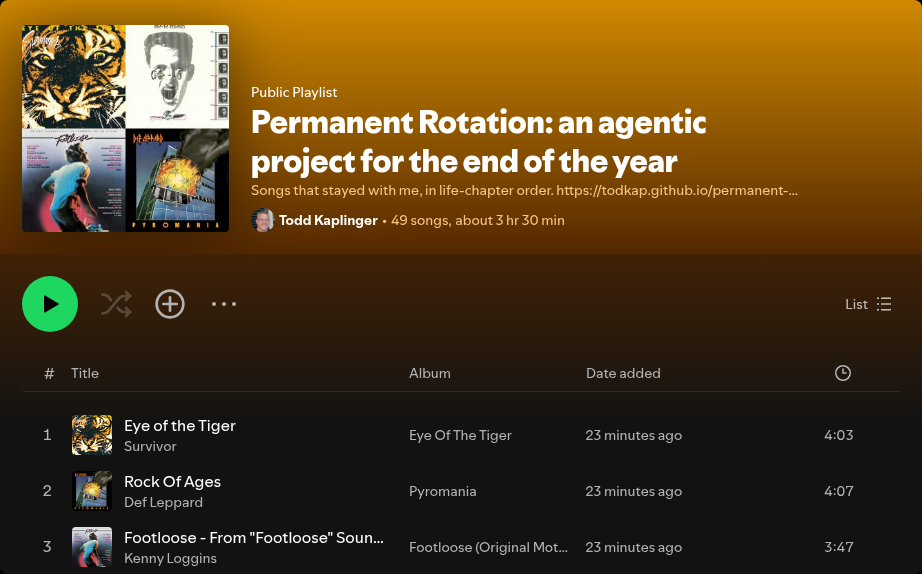

# Permanent Rotation: an agentic project for the end of the year

*Photo: [King of Hearts](https://commons.wikimedia.org/wiki/File:Boston_skyline_from_Longfellow_Bridge_September_2017_panorama_2.jpg), CC BY-SA 4.0, via Wikimedia Commons*

Every December I take a break from the office and use part of it to go hands on with a technology I did not have time for during the year. Projects like this have always belonged to downtime, because downtime was the only block of time big enough to hold them. That assumption broke this year. With an agent doing the typing, a real app now fits into a few afternoons, something both fun and interesting. So this year's holiday build is about music, and the stakes were personal instead of professional.

### The idea

Earlier this fall I wrote about the songs that stayed with me. The list started at 30 and kept growing once I stopped trying to rank them and just asked which songs had earned a permanent spot. It sits at 50 now. Each one has a few sentences in my own words about what it means and when it entered my life.

The list lived in a spreadsheet. So the project became permanent-rotation, a small open source tool that turns a spreadsheet of your songs into a personal site and a Spotify playlist. My list is the sample that ships with it. The repo is built so you can fork it and make your own.

### What the tool does

The repo is a small Go program plus a GitHub Action. You edit a CSV with six columns: song, artist, era, tags, memory and angle. Only song and artist are required. When you run the Action, it matches each song against Spotify, pulls listener and play counts from Last.fm, optionally asks Gemini to write a short background note, and publishes a static site to GitHub Pages. An optional local Mac script builds your playlist after a Spotify browser sign-in and an explicit confirmation. The site build itself stays in GitHub Actions; playlist creation is a separate step.

A few decisions shaped everything else:

- Your words are the source of truth. The APIs only add labeled context around them. My memory text is published verbatim, and anything the machine adds sits in its own labeled block.
- The CSV is the thing you edit, not a database or a config format. It opens in Sheets, and the bar for forking stays low.
- The Action commits the enriched data only when something changed. The diff is your audit trail, and the page footer shows "data as of".
- There is no ranking. The site groups songs by the chapters of your life.

The final round made the site itself more visual. Every card now carries its album cover from Spotify, there is a stats page (50 songs across five eras, 1971 to 2020, 25 seen live), and the titles are the official ones. That last one sounds small, but it shows on every card: it is The Freshmen, not Freshman, and There Is a Light That Never Goes Out.

### The APIs, and why those

Spotify was the obvious first choice for matching songs and building the playlist. There is a catch worth knowing about. Since February 2026, new Spotify developer apps run in Development Mode: one client ID, five authorized users, and no popularity field. That last one mattered, because every song gets a label: canon, middle or deep cut.

That is where Last.fm came in. Last.fm still exposes listener and play counts, so the tiers are computed from your own list: the top third of your songs by listeners reads as canon, the bottom third as deep cuts. It is today's popularity, not the popularity of the year the song came out. A track that was obscure in 1987 but famous now is canon in 2026.

Gemini writes the optional background notes, the short paragraphs that sit next to a song and explain where it came from. That step is opt in, paced slowly to respect the free tier, and every note must carry a source URL or it gets dropped. More on why that rule exists below.

MusicBrainz was the first choice for the album and year, and it turned out to be a trusted-looking source that was wrong in a different way. Its release-group search returned a tribute album, Mayonaise Dream, when the tool asked about Mayonaise, and a Songs of Ben Folds compilation when it asked about Brick, and it rate-limited the run besides. So the album and year now come from the song's own Spotify match in the repo's data. MusicBrainz stays on as a cross-check on release years, because remastered albums often report a later year than the original. When Spotify and MusicBrainz disagree, the tool flags the disagreement instead of silently picking one.

### Where the agent was wrong

Most articles about agents skip this part.

The first run of background notes looked great. Clean paragraphs, confident tone. Then my assistant, Instinct, checked every note against Wikipedia, and it turned out the model had invented facts with complete confidence. 
- It said The Old Apartment was from a Barenaked Ladies album called Born on a Gerrard Street. The album is Born on a Pirate Ship. On a later run it invented a different street, Dunedin, which was almost impressive.
- It put Edwin McCain's I'll Be on an album called Messenger. The album is Misguided Roses.
- It credited Bill Berry with the piano on Nightswimming. That is Mike Mills.

The fix was not to hand-edit the paragraphs. The fix was to change the generator. We tightened the prompt to say a shorter accurate note is better than a longer wrong one, deleted the bad notes, and regenerated all 41 from scratch. Most came back correct. Two songs kept failing to get a note at all, and two kept hallucinating album names no matter how the prompt read.

The real fix was to stop trusting the model's memory altogether. The tool now pulls the facts first: album and release year from the song's own Spotify match, chart position and background from the song's Wikipedia article. The model gets those facts as the only ones it is allowed to use, a validator rejects any note that names a year or an album title that is not in them, and every note links to the real Wikipedia article it came from. **Retrieval first, generation second.**

The first grounded run wrote all 41 notes, and the five that had been wrong or missing came back correct. One detail from that first version: for The Old Apartment, MusicBrainz knew the 1997 single and Wikipedia knew the album was Born on a Pirate Ship. The two sources covered each other's gaps, even though MusicBrainz did not survive as the album source.

If there is one sentence to take away from this article, it is that one: **I stopped trusting the model's memory and gave it sources.**

### Where memory beats the data

The most personal column in the spreadsheet is era. It is not the release year. It is the year the song entered your life. Hey Ya came out in 2003, but on my list it is 2004, because my son was born in December 2003 and that song is welded to those first few months. No API has that. The tool treats your year as the truth and the release year as context, which is backwards from how music software usually works and exactly right for this.

Memory mostly held up in one more place: the shows. For the songs I saw live, Instinct checked what I remembered against the recorded setlists and tour archives. I would have sworn the Toad the Wet Sprocket show was 1993 or 1994; it was 1995. And I had the Beastie Boys and Smashing Pumpkins at a Lollapalooza in Rhode Island around 1997. The record says Lollapalooza 1994, Quonset State Airport in Kingston, August 3, 1994, with the Pumpkins headlining and A Tribe Called Quest on the same bill. That one memory, pinned to a real date, put three more songs on the seen-live list: So What'Cha Want, Mayonaise and Scenario. The count is 25 now, and every tag has a source behind it.

Matching is deterministic, cached, and honest about failure. Any match the tool is unsure about gets printed for you to confirm, and you can pin one by hand in an overrides file. A song that cannot be matched still renders, your words and its note intact, just without a Spotify link. Deep Cover is on my list and stayed unmatched, because the alternative was faking a link to the wrong track. Nothing is ever invented. I wish I could say the same for the background notes on their first pass.

### Built without a terminal

One more thing worth noting. The entire project, from first commit to deployed site, ran through the GitHub web UI. Edit the CSV in the browser, commit, open the Actions tab, tick the box that says regenerate notes, run the workflow. The keys live in repository secrets.

The Action is the whole backend. One workflow matches the songs against Spotify, pulls the Last.fm numbers, checks background against Wikipedia, optionally repairs a batch of Gemini notes, renders the site, commits the refreshed data back to the repo, and deploys the result to GitHub Pages. There is no web server to stand up and no API to keep alive. The API calls happen once, at build time; what Pages serves is plain files. I never opened a terminal to build and publish the site. The whole flow is closer to maintaining a playlist than running a software project. The optional Spotify playlist script is the exception: it runs locally on my Mac. For a holiday build, that felt about right.

### By the numbers

Some scale, at the time of writing. 106 commits on main and climbing. 13 pull requests, all merged. 55 runs of the build Action. 44 of those commits are the Action checking in refreshed data on its own; the rest are me in the browser. 106 test functions across nine test files. Go for the tool, one shell script for the playlist, 50 songs.

What the numbers do not show is how it got built. Not in one shot, and not by handing an agent a prompt and walking away. It was an iterative, agentic conversation with Instinct: a step at a time, my decisions and my merges in between, the agent doing the typing. Human in the loop, start to finish.

### Make your own

Part of the fun was putting my own taste on the internet, every song with its story attached. The bigger hope is that someone reads this and makes their own version. If that is you:

1. Fork the repo at github.com/todkap/permanent-rotation.
2. Replace songs.csv with your list. Pick at least 25 songs, and there is no maximum. The minimum is the point, because it forces you past the obvious ones.
3. Get three free keys: a Spotify developer app (you need Premium), a Last.fm API key, and optionally a Gemini API key for the background notes. Add them as GitHub repository secrets.
4. Run the Action.

The README walks through getting each key step by step.

### Listen to it

[The playlist is on Spotify](https://open.spotify.com/playlist/3Mx9a5o9ZQW5v6nqoKUllO), public, with 49 songs. Deep Cover never matched a Spotify track, so it stays on the site with its note but is not in the playlist.

### A thank you

One collaborator on this build was not a person. Instinct, my AI assistant, checked the facts, ran down the setlists, and caught the details I would have shipped wrong. The invented album names are funny in this article because they got caught. Working with an agent that checks its own work against sources changed how I think about the tools I spend my week on. Thanks, Instinct.

Instinct is still early stage and invite-only, which I love. I have a few invites. If you want one, comment or message me on LinkedIn with what you would hand off first, and I will pick from those.

### Wrapping up the year

The habit underneath these articles is simple: I reserve December to invest in my own technical growth. Most years that becomes an article, some years it is just a project. The theme ends up the same: the best way to understand a technology is to build something you care about with it. This year, that lesson came from watching an agent confidently invent a Barenaked Ladies album. My list is live at https://todkap.github.io/permanent-rotation/index.html if you want to see what 50 songs look like with their notes, canon labels and all.

Happy holidays. Go make your list.
